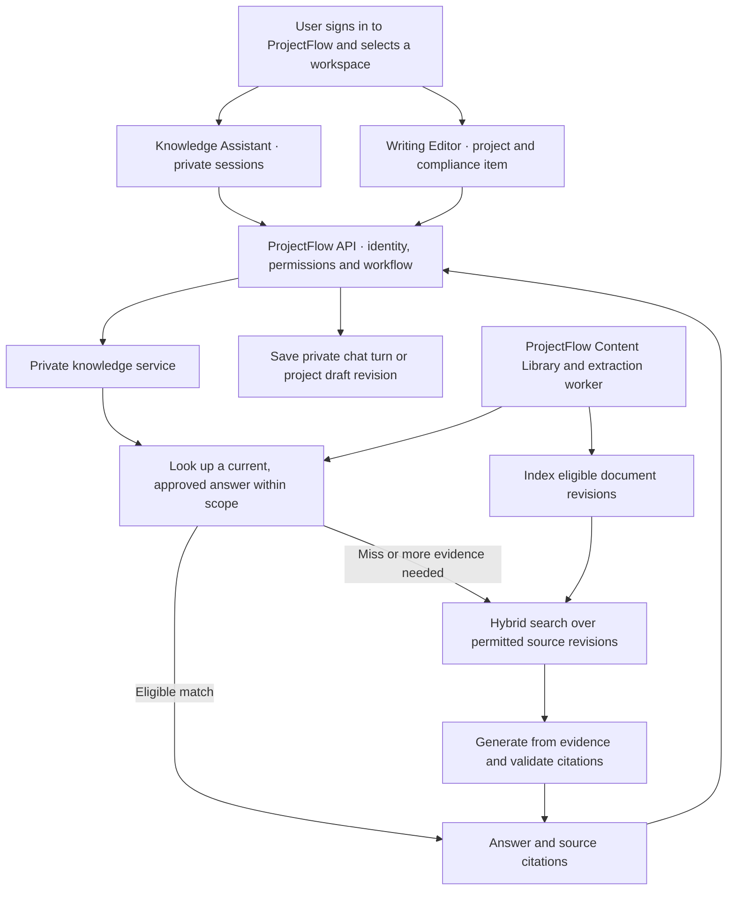

# Phase 3 integration plan for ProjectFlow

**Proposal for the M.Tech demo and subsequent product development.** ProjectFlow is called ProposalFlow in the current application repository. The design gives each workspace a private Knowledge Assistant and a proposal Writing Editor. Both use the same identity, evidence and citations. They differ in who can see the output and what that output can do.

## Where the two projects meet

| Available today | Integration decision |
| --- | --- |
| ProjectFlow's Next.js workspace, Supabase sign-in, and FastAPI membership checks for owners, editors and reviewers | Add **Knowledge Assistant** to the existing workspace navigation and **Draft from library** to a selected compliance item. Use the signed-in session for both. |
| ProjectFlow's private document library, extraction worker, RFP intake and editable requirement list | Index the existing extracted text once. Keep document IDs and original page, paragraph, line or spreadsheet locations. An extracted document needs an explicit decision about its audience and eligibility as company evidence. |
| Enterprise RAG's hybrid retrieval pattern, provider failover, and token and latency reporting | Reuse these components behind a private service. The Phase 2 role filter currently returns every chunk, uploads share a blanket role tag, and the sparse retriever loads the full collection. |
| ProjectFlow's M5–M7 roadmap | M5 owns answer revisions and the editor, M6 owns retrieval and grounded drafting, and M7 owns formal review and approval. Build retrieval once for chat and M6. |

## Target architecture

**ProjectFlow owns the records and permissions.** It owns users, workspace memberships, document grants, projects, requirements, chat sessions, and draft revisions. Each request validates the session and derives the actor's scope on the server. Chat also checks session ownership. Drafting checks project access, the selected item's membership in that project, and permission to draft. The browser calls the ProjectFlow API only.

**The knowledge service owns retrieval and generation.** The API calls it with an authenticated, short-lived internal identity bound to the user and workspace, plus the operation and optional project/item. The service resolves current source grants from the authoritative store. Both keyword and vector searches apply workspace, audience, project scope when applicable, approval and active revision constraints before ranking or passing passages to a model. Citation preview, FAQ reuse and reopening history must also respect current access. For the MVP, store an answer's source dependencies and withhold a source-backed answer if any dependency becomes inaccessible.

**Use one logical evidence pool.** Keep originals in ProjectFlow's private storage. For the product, start with Postgres full-text search and pgvector alongside the existing workspace and document metadata. This allows both searches to use the same permission predicates. Prefer user-scoped database access with row-level security for reads. The existing API also uses privileged database access, so a privileged retrieval path needs an explicit, tested scope check. Each indexed chunk identifies its workspace, document, revision and original location. Index jobs use document and revision IDs for safe retry. An archive, replacement or grant change must affect reads immediately, even while background index cleanup is pending. [Supabase hybrid search](https://supabase.com/docs/guides/ai/hybrid-search) · [Supabase row-level security](https://supabase.com/docs/guides/database/postgres/row-level-security)

## Two user experiences

The proposed service contract has two operations. `answer_question` accepts the current turn and permitted session context. `draft_response` accepts a server-resolved requirement, format and any applicable buyer constraints. Both return text, source revision and location for each citation, missing information, the retrieval route, and usage. ProjectFlow stores the result against the session or response item only after checking ownership and the current revision. A timeout or retry should never create duplicate turns or draft revisions.

| | Knowledge Assistant | Writing Editor |
| --- | --- | --- |
| Starting point | Start or resume a private conversation in the selected workspace. Follow-ups can use that user's permitted session history. | Open a compliance matrix row. The requirement text, buyer constraints and original location come from the selected project and item. |
| Expected answer | Cite company facts. Label brainstorming as suggestions and keep ideas distinguishable from documented capabilities. | Draft in the requested response format. Return supporting citations and any missing facts. Keep the buyer's requirement citation distinct from evidence of the company's ability to meet it. |
| Visibility and action | Session history belongs to the user within that workspace. Show recent chats, evidence, and whether the answer came from approved Q&A or document search. | ProjectFlow saves a draft revision, retains edits, and applies reviewer assignment and approval. A generation call alone cannot approve a commitment. |
| Handoff | **Use in proposal** lets the user choose a project and item, preview what will transfer, and explicitly create a draft. | Recheck every cited source against the destination audience and regenerate from eligible evidence if scope narrows. Transfer the selected material only. |

## How the Content Library improves with use

1. An owner or designated publisher approves company evidence for a defined audience. A buyer questionnaire can define a project requirement. A previous proposal can contribute reusable evidence after review for buyer-specific claims, dates and permitted audience.
2. Store each approved Q&A with its canonical question, answer, citations, source revisions, audience, approver and validity period where applicable. Its effective audience is also constrained by every supporting source.
3. Use semantic similarity to find candidate paraphrases. Check the entity, time period, scope and all material conditions before reuse. A question about premium support must miss a standard-support FAQ, even if both ask for response time.
4. A valid hit can answer a factual chat question directly. In the editor it can prefill a matching requirement. A compound requirement can reuse a verified fact and still show open clauses. Otherwise run one authorized hybrid retrieval path and identify evidence gaps.
5. User feedback nominates an answer for editorial review. Approval publishes the reusable Q&A. Source replacement or expiry retires the old answer until reverified. Access revocation takes effect on the next read.

## Branches and rollout

Develop the reusable service on the existing Enterprise RAG `phase-3` branch and keep `v2.0-phase2` as the baseline for the four research pipelines. Use a short-lived ProjectFlow feature branch such as `codex/knowledge-assistant` for the web UI, API adapter, schema and worker changes. Review the request/response contract in both repositories and merge the product feature back through ProjectFlow's normal workflow. The service can run as a second local process for the demo and deploy independently later.

| Order | Deliverable | Acceptance check |
| --- | --- | --- |
| 1. Secure retrieval | Connect one approved, already-extracted document to the private service through ProjectFlow. Return a source revision, location and excerpt. | An authorized member gets the supporting passage. A second workspace and a same-workspace member lacking its grant receive no matching passage or citation preview. |
| 2. Private chat | Add a session sidebar, new/resume chat, evidence drawer and brainstorming. Persist sessions by workspace and owner. | The owner can resume after signing out. A colleague cannot open the session. Losing source access also removes access to dependent answers. |
| 3. Verified Q&A | Add nomination, publisher review, audience, source dependencies, paraphrase matching and invalidation. | A paraphrase in a new session reuses an approved answer. A changed entity or period misses. Archiving the source disables both the FAQ hit and document retrieval. A member lacking its grant cannot retrieve the saved Q&A. |
| 4. Editor integration | Connect M5 answer revisions and M6 generation to the same service. Add explicit chat-to-draft handoff and M7 review when available. | A requirement gets a cited draft, unsupported clauses are visible, and the draft survives reload. A reviewer can verify evidence before approving. A second generation cannot silently overwrite human edits. |
| 5. Demo and measurement | Record route, latency, input and output generation tokens, embedding usage where available, and citation coverage. | Compare a cold question and a warm paraphrase, show a scoped-access denial, then produce a reviewable draft from the same approved fact. Record observed values. |

**Example demo.** Ask “Who approves a production change?” in a private session. Review the cited policy and approve a reusable Q&A. In a fresh session ask “Whose sign-off do we need before deploying?” and show the approved-answer route. Then open a buyer requirement asking who approves changes *and how long records are retained*. The editor can draft the approval clause from the same policy and flag retention as missing if there is no permitted source. Replace the policy and show that the old wording immediately becomes ineligible for reuse.

## Implementation references

- ProjectFlow repository (`D:/Proposal_SaaS`) — `apps/web/app/page.tsx`, `apps/api/main.py`, `apps/api/worker.py`, `apps/api/schemas/response_item.schema.json` and `Tracker/06_MVP_Roadmap_and_Execution_Tracker.md`.
- Enterprise RAG repository — [retrieval and index construction](main.py), [provider failover](llm_router.py) and [research UI](rag-frontend/src/App.jsx).

### Integration checkpoint

Live ProjectFlow chat and verified paraphrase reuse were confirmed. The companion ProjectFlow branch is `codex/knowledge-assistant`, with migrations 014 through 019. The next product acceptance check covers the chat-to-proposal handoff, citations, missing evidence and review. Formal RAGAS evaluation remains pending.
